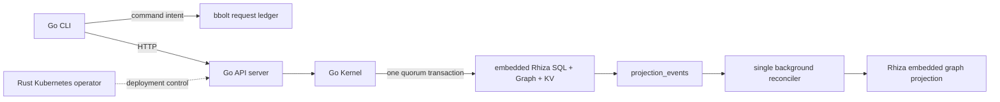

# Runtime Topology

## Current supported topology

The Go server and Kernel are the only implemented canonical runtime. Rhiza mode
embeds one Rhiza v0.19.0 node in each server process; no standalone database
server is started. Rhiza materializes SQL, Graph, and KV together. SQLite-only
mode remains a single-node local/test option. The Rust workspace contains only
the Kubernetes operator; there is no Rust reference server or Rust Kernel.

Rhiza v0.19.0 uses latticedb-go v0.11.3 and SQL execution policy 7. It rejects
earlier Rhiza materializations, checkpoints, SQL history, WAL artifacts, and
mixed-version peers. Therefore v0.19.0 is a fresh-cluster release for an
existing installation: retain the old compatible runtime, export verified
application state, import it into fresh data directories, object-store prefix,
and peer identities, then validate before traffic cutover. A physical Rhiza or
LatticeDB file/checkpoint backup is not that migration and image downgrade is
not rollback. This also applies to a v0.18.0 cluster with SQL policy 4. See the
[Rhiza release notes](https://github.com/mrchypark/rhiza/releases/tag/v0.19.0).

## Write path

1. The CLI durably appends its command intent to the local request ledger.
2. The Go server authenticates the request and submits it to the Go Kernel.
3. The Kernel validates authorization, schema, relations, state transitions and
   compare-and-set preconditions.
4. One embedded Rhiza quorum transaction commits business state, the command
   ledger, activity, outbox event and projection event.
5. The HTTP mutation response depends only on that canonical commit. Graph
   projection work is never performed in a mutation request path.

## Knowledge projection path

`projection_events` is the durable outbox. One in-process reconciler consumes
Knowledge events in workspace sequence order and reads the current canonical
Concept snapshot from SQL. A valid cursor catches up incrementally; a missing,
incompatible or corrupt projection is rebuilt from canonical SQL.

The graph is a rebuildable derived view inside the same Rhiza v0.19.0 runtime and
is included in Rhiza checkpoints with SQL and KV. In Rhiza mode it starts
automatically and serves only bounded outgoing unique reachability. Cursor and
digest are returned as its watermark; stale projections fail closed.
Reachability compares the persisted cursor with a fresh linearizable Knowledge
head and uses `RequireAppliedSlot` to bind the graph query to that read version.
The local reconciler lock excludes partial local updates. Concurrent projector
publication and crash-rebuild atomicity are separate HA gates, not implied by
this process-local lock or by the shared Rhiza storage engine.

## Read path

The CLI reads the Go server. Canonical object, command and Knowledge detail
reads come from canonical SQL (Rhiza in deployed mode, SQLite only locally and
in tests). Full-text search uses the rebuildable external Meilisearch projection
and exact bounded ontology path traversal uses canonical SQL. The separate
`reachable-node-ids` endpoint explicitly selects the Rhiza graph and fails
unavailable when that projection is absent or stale.

## Kubernetes operator boundary

The Rust operator is built and tested independently from the Go runtime. Its
current contract renders PVC-free `emptyDir` local materialization, `Parallel`
StatefulSet startup, fixed membership, and shared object-store durability. This
removes the initial quorum/`OrderedReady` deadlock; it does not prove a live
multi-node rollout. tg900 is intentionally a one-node Rhiza deployment with
GCS `before-ack` recovery durability. On 2026-10-08 its v0.12 application state
was logically migrated to v0.19.0 under a fresh cluster, object-store namespace,
and peer identity. Full row comparison passed before and after GCS cold recovery;
the old namespace remains an archive, not a writer. See the
[migration record](../plans/rhiza-v012-v019-logical-migration.md). Multi-node failover,
upgrade, and replacement remain explicit integration gates. Keeping deployment
control separate does not justify retaining a second server or Kernel
implementation.

## Forbidden paths

- CLI direct database mutation.
- Automation or adapter direct database mutation.
- Graph projection as command or event authority.
- Synchronous graph projection in an HTTP mutation request.
- Rhiza Graph serving search, grounding, path-row traversal or any request other
  than the explicit bounded unique-reachability capability.
- More than one active Go server process for a SQLite database.
