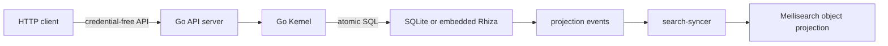

# Runtime Topology

## Current supported topology

The Go server and Kernel are the only canonical runtime. `standalone/sqlite`
supports one active server per database. `standalone/rhiza` runs one embedded
Rhiza node. `ha/rhiza` uses multiple Rhiza members and requires object-store
`before-ack` durability. No standalone database server is started.

The CLI, local request ledger, embedded web console, Rust operator, Helm chart,
and CRDs have been removed. Kubernetes deployment is direct manifest or an
external deployment system.

## Write path

1. An HTTP client sends a Kernel command.
2. The server applies fixed principal attribution `local`; credential and
   authorization checks are outside Compos.
3. The Kernel validates command shape, schema, relations, state transitions and
   compare-and-set preconditions.
4. SQLite commits in one transaction. Rhiza commits canonical state, command
   ledger, activities, outbox and projection events in one bounded SQL batch.
5. The HTTP response depends only on the canonical commit. External execution
   and search indexing may still be pending.

## Read and projection path

Canonical object and command reads use SQL. Meilisearch is an external derived
index rebuilt by `search-syncer`; it is not a source of business truth. The
server enforces the workspace filter and removes hits without a valid
`object_id`. Knowledge belongs outside Compos; generic Ontology specs remain.

## Forbidden paths

- Direct business-state database mutation outside the Kernel boundary.
- More than one active server process for a SQLite database.
